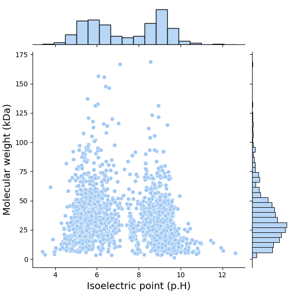
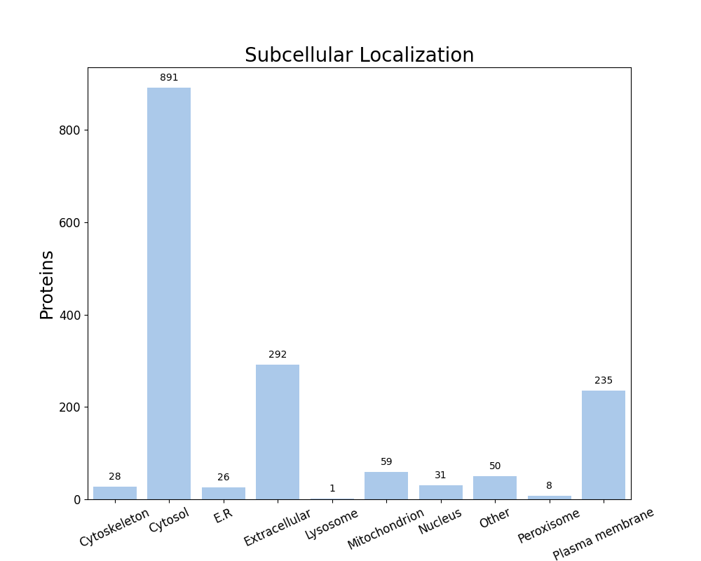

FastProtein Software 1.0
========================
##### Protein Information Software

---
### Summary
| Information                          | Value              |
| ------------------------------------ | ------------------ |
| Processed proteins                   | 1621               |
| Molecular mass (kda) mean            | 35.41 &#177; 22.50 |
| Isoelectric point mean               | 7.38 &#177; 1.75   |
| Hydrophicity mean                    | -0.12 &#177; 0.46  |
| Aromaticity mean                     | 0.10 &#177; 0.04   |
| Proteins with TM                     | 372                |
| Proteins with SP                     | 274                |
| Proteins with GPI                    | 12                 |
| Membrane proteins                    | 383                |
| Proteins with E.R Retention domains  | 317                |
| Proteins with NGlycosylation domains | 1223               |
### Molecular mass (kDa) vs Isoelectric point (pH)

---
### Subcellular localization (by WolfPSort) - Organism: animal

| Subcellular localization | Proteins |
| ------------------------ | -------- |
| Cytosol                  | 891      |
| Extracellular            | 292      |
| Plasma membrane          | 235      |
| Mitochondrion            | 59       |
| Other                    | 50       |
| Nucleus                  | 31       |
| Cytoskeleton             | 28       |
| E.R                      | 26       |
| Peroxisome               | 8        |
| Lysosome                 | 1        |
---
### E.R Retention domain summary
| Domain | Quantity |
| ------ | -------- |
| QNEL   | 15       |
| KEEL   | 74       |
| KDEL   | 32       |
| SNEL   | 22       |
| ADEL   | 15       |
| KNEL   | 29       |
| ANEL   | 28       |
| SDEL   | 21       |
| KQEL   | 16       |
| SEEL   | 21       |
Only top 10

---
### NGlyc domain summary
| Domain | Quantity |
| ------ | -------- |
| NAS    | 166      |
| NLS    | 376      |
| NKT    | 137      |
| NLT    | 146      |
| NIT    | 151      |
| NIS    | 218      |
| NFS    | 141      |
| NES    | 141      |
| NFT    | 127      |
| NSS    | 136      |
Only top 10

---
| Id     | Length |  kDa   | Isoelectric_Point | Hydropathy | Aromaticity |  Localization   | TMHMM_2 | Phobius_TM | PredGPI | Membrane_evidences | Membrane_evidences_detail | SignalP5 | Phobius_SP | ER_Retention_Total | NGlyc_Total |   ER_Retention_Domains    |                                                           NGlyc_Domains                                                           |                                                     Header                                                      | Local_alignment_description | Gene_Ontology | Interpro_Annotation | PFAM_Annotation | Panther_Annotation |
| ------ |:------:|:------:|:-----------------:|:----------:|:-----------:|:---------------:|:-------:|:----------:|:-------:|:------------------:|:-------------------------:|:--------:|:----------:|:------------------:|:-----------:|:-------------------------:|:---------------------------------------------------------------------------------------------------------------------------------:|:---------------------------------------------------------------------------------------------------------------:| --------------------------- | ------------- | ------------------- | --------------- | ------------------ |
| Q0P8H3 |  393   | 45.09  |       8.48        |   -0.18    |    0.11     |       E.R       |    0    |     0      |    -    |         0          |                           |    -     |     Y      |         0          |      2      |                           |                                                      NIS[58-61];NMS[133-136]                                                      |                                           UDP-glucose 6-dehydrogenase                                           | -                           |               |                     |                 |                    |
| Q0P9C4 |  564   | 64.74  |       8.99        |    0.20    |    0.12     | Plasma membrane |    0    |     6      |    -    |         2          |    PHOBIUS_TM&#124;SL     |    -     |     -      |         0          |     10      |                           | NQS[127-130];NLS[141-144];NIT[248-251];NES[251-254];NES[281-284];NLS[352-355];NNT[415-418];NDS[435-438];NIT[441-444];NLS[483-486] |                                             Protein glycosylation K                                             | -                           |               |                     |                 |                    |
| Q0P9C5 |  359   | 41.16  |       8.66        |   -0.08    |    0.11     |     Cytosol     |    0    |     0      |    -    |         0          |                           |    -     |     Y      |         1          |      0      |       RQEL[225-229]       |                                                                                                                                   | GalNAc-alpha-(1->4)-GalNAc-alpha-(1->3)-diNAcBac-PP-undecaprenol alpha-1,4-N-acetyl-D-galactosaminyltransferase | -                           |               |                     |                 |                    |
| Q0P9D1 |  195   | 21.15  |       8.45        |    0.16    |    0.08     |     Cytosol     |    0    |     0      |    -    |         0          |                           |    -     |     -      |         0          |      2      |                           |                                                     NTS[117-120];NLS[161-164]                                                     |                                  UDP-N-acetylbacillosamine N-acetyltransferase                                  | -                           |               |                     |                 |                    |
| O69290 |  427   | 47.72  |       6.09        |   -0.18    |    0.08     |     Cytosol     |    0    |     0      |    -    |         0          |                           |    -     |     -      |         0          |      2      |                           |                                                     NIT[156-159];NQT[231-234]                                                     |                      UDP-N-acetylmuramoyl-L-alanyl-D-glutamate--2,6-diaminopimelate ligase                      | -                           |               |                     |                 |                    |
| Q0P7R8 |  356   | 40.25  |       9.28        |   -0.24    |    0.06     |     Cytosol     |    0    |     0      |    -    |         0          |                           |    -     |     -      |         0          |      3      |                           |                                               NFS[38-41];NLS[138-141];NVS[179-182]                                                |                                   Dual-specificity RNA methyltransferase RlmN                                   | -                           |               |                     |                 |                    |
| Q0P8H7 |  367   | 41.93  |       6.12        |   -0.16    |    0.11     |     Cytosol     |    0    |     0      |    -    |         0          |                           |    -     |     -      |         0          |      5      |                           |                                   NSS[21-24];NSS[79-82];NDS[297-300];NIS[310-313];NYS[327-330]                                    |                                 Dihydroxyacetone phosphate transaminase Cj1437c                                 | -                           |               |                     |                 |                    |
| Q0P8I7 |  313   | 35.60  |       8.13        |   -0.20    |    0.11     |     Cytosol     |    0    |     0      |    -    |         0          |                           |    -     |     -      |         0          |      2      |                           |                                                      NFT[49-52];NLT[238-241]                                                      |                                GDP-D-glycero-alpha-D-manno-heptose dehydrogenase                                | -                           |               |                     |                 |                    |
| Q0P8I9 |  339   | 38.14  |       8.64        |   -0.29    |    0.12     |     Cytosol     |    0    |     0      |    -    |         0          |                           |    -     |     -      |         0          |      2      |                           |                                                      NAT[33-36];NIT[204-207]                                                      |                               D-glycero-alpha-D-manno-heptose 7-phosphate kinase                                | -                           |               |                     |                 |                    |
| Q0P8J1 |  221   | 25.66  |       5.30        |   -0.14    |    0.14     |     Cytosol     |    0    |     0      |    -    |         0          |                           |    -     |     -      |         0          |      1      |                           |                                                           NES[117-120]                                                            |                         D-glycero-alpha-D-manno-heptose 1-phosphate guanylyltransferase                         | -                           |               |                     |                 |                    |
| Q0P8J6 |  779   | 90.32  |       5.94        |   -0.34    |    0.12     |     Cytosol     |    0    |     0      |    -    |         0          |                           |    -     |     -      |         2          |      8      | KDEL[85-89];KEEL[202-206] |              NIT[114-117];NFS[128-131];NGS[140-143];NSS[143-146];NSS[366-369];NFS[427-430];NLS[490-493];NHS[676-679]              |                                               L-glutamine kinase                                                | -                           |               |                     |                 |                    |
| Q0P8J9 |  170   | 19.88  |       6.74        |   -0.39    |    0.10     |     Cytosol     |    0    |     1      |    -    |         1          |        PHOBIUS_TM         |    -     |     -      |         0          |      1      |                           |                                                           NNS[149-152]                                                            |                                        Cytidine diphosphoramidate kinase                                        | -                           |               |                     |                 |                    |
| Q0P8U5 |  274   | 31.32  |       5.94        |   -0.17    |    0.10     |     Cytosol     |    0    |     0      |    -    |         0          |                           |    -     |     -      |         0          |      2      |                           |                                                     NLS[170-173];NES[223-226]                                                     |                        UDP-2,4-diacetamido-2,4,6-trideoxy-beta-L-altropyranose hydrolase                        | -                           |               |                     |                 |                    |
| Q0P9C8 |  713   | 82.20  |       8.30        |    0.41    |    0.17     | Plasma membrane |    0    |     11     |    -    |         2          |    PHOBIUS_TM&#124;SL     |    -     |     -      |         0          |      4      |                           |                                        NRT[143-146];NLT[299-302];NQT[310-313];NQS[533-536]                                        |                         Undecaprenyl-diphosphooligosaccharide--protein glycotransferase                         | -                           |               |                     |                 |                    |
| Q0P9D3 |  386   | 43.65  |       6.43        |   -0.23    |    0.10     | Plasma membrane |    0    |     0      |    -    |         1          |            SL             |    -     |     -      |         1          |      2      |       KNEL[290-294]       |                                                     NIS[301-304];NIT[306-309]                                                     |                                     UDP-N-acetylbacillosamine transaminase                                      | -                           |               |                     |                 |                    |
| Q0PA68 |  384   | 43.29  |       8.54        |   -0.10    |    0.09     |  Extracellular  |    0    |     0      |    -    |         0          |                           |    -     |     Y      |         1          |      6      |       QNEL[350-354]       |                            NES[59-62];NIT[167-170];NKS[181-184];NFS[203-206];NLS[254-257];NKS[362-365]                            |                               Coenzyme A biosynthesis bifunctional protein CoaBC                                | -                           |               |                     |                 |                    |
| Q0PAA2 |  163   | 19.38  |       4.60        |   -0.75    |    0.05     |     Cytosol     |    0    |     0      |    -    |         0          |                           |    -     |     -      |         1          |      1      |        KDEL[39-43]        |                                                           NLT[143-146]                                                            |                                        Campylobacter invasion antigen D                                         | -                           |               |                     |                 |                    |
| Q0PB48 |  127   | 14.97  |       5.57        |   -0.52    |    0.13     |     Cytosol     |    0    |     0      |    -    |         0          |                           |    -     |     -      |         0          |      0      |                           |                                                                                                                                   |                                        Group 3 truncated hemoglobin ctb                                         | -                           |               |                     |                 |                    |
| Q0PC20 |  229   | 25.23  |       5.05        |    0.15    |    0.09     |     Cytosol     |    0    |     0      |    -    |         0          |                           |    -     |     -      |         0          |      2      |                           |                                                       NNT[30-33];NST[54-57]                                                       |                                        Aminodeoxyfutalosine nucleosidase                                        | -                           |               |                     |                 |                    |
| Q6TG07 |  172   | 20.25  |       5.80        |   -0.34    |    0.14     |     Cytosol     |    0    |     0      |    -    |         0          |                           |    -     |     -      |         0          |      2      |                           |                                                      NQS[51-54];NLS[125-128]                                                      |                         D-glycero-alpha-D-manno-heptose-1,7-bisphosphate 7-phosphatase                          | -                           |               |                     |                 |                    |
| Q6TG09 |  461   | 51.24  |       5.67        |    0.01    |    0.08     |   Peroxisome    |    0    |     0      |    -    |         0          |                           |    -     |     -      |         1          |      1      |       KEEL[317-321]       |                                                            NYT[21-24]                                                             |                                            Bifunctional protein HldE                                            | -                           |               |                     |                 |                    |
| Q9PHN5 |  340   | 36.93  |       6.10        |   -0.05    |    0.07     |     Cytosol     |    0    |     0      |    -    |         0          |                           |    -     |     -      |         0          |      3      |                           |                                                NVT[42-45];NLS[97-100];NDS[310-313]                                                |                                      Ketol-acid reductoisomerase (NADP(+))                                      | -                           |               |                     |                 |                    |
| Q9PIL7 |  1089  | 120.94 |       5.59        |   -0.12    |    0.08     |     Cytosol     |    0    |     0      |    -    |         0          |                           |    -     |     -      |         0          |      6      |                           |                          NAS[263-266];NTT[366-369];NVS[543-546];NST[692-695];NAT[758-761];NTS[1029-1032]                          |                                    Carbamoyl phosphate synthase large chain                                     | -                           |               |                     |                 |                    |
| Q9PJ84 |  543   | 60.40  |       6.32        |   -0.17    |    0.07     |     Cytosol     |    0    |     0      |    -    |         0          |                           |    -     |     Y      |         0          |      2      |                           |                                                      NFT[89-92];NSS[401-404]                                                      |                                                  CTP synthase                                                   | -                           |               |                     |                 |                    |
| Q9PLZ2 |  700   | 79.15  |       9.06        |   -0.50    |    0.08     |     Cytosol     |    0    |     0      |    -    |         0          |                           |    -     |     -      |         1          |      5      |       KDEL[365-369]       |                                 NLS[351-354];NVT[502-505];NFS[510-513];NES[610-613];NGT[622-625]                                  |                                               DNA topoisomerase 1                                               | -                           |               |                     |                 |                    |
| Q9PM40 |  224   | 24.96  |       6.99        |   -0.20    |    0.08     |     Cytosol     |    0    |     0      |    -    |         0          |                           |    -     |     -      |         0          |      0      |                           |                                                                                                                                   |                                                 Ribonuclease 3                                                  | -                           |               |                     |                 |                    |
##### Only top 10 proteins

---

##### Do you have a question or tips? Please contact us! E-mail: renato.simoes@ifsc.edu.br
Generated time: Mon Sep 28 19:03:14 UTC 2026